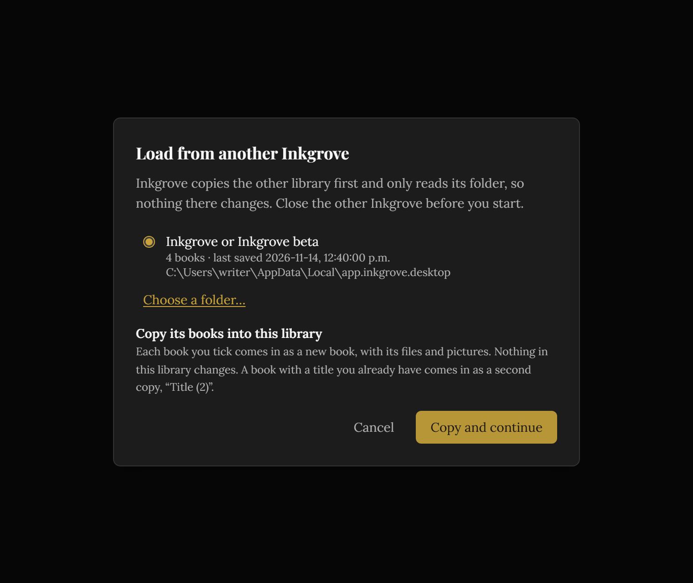
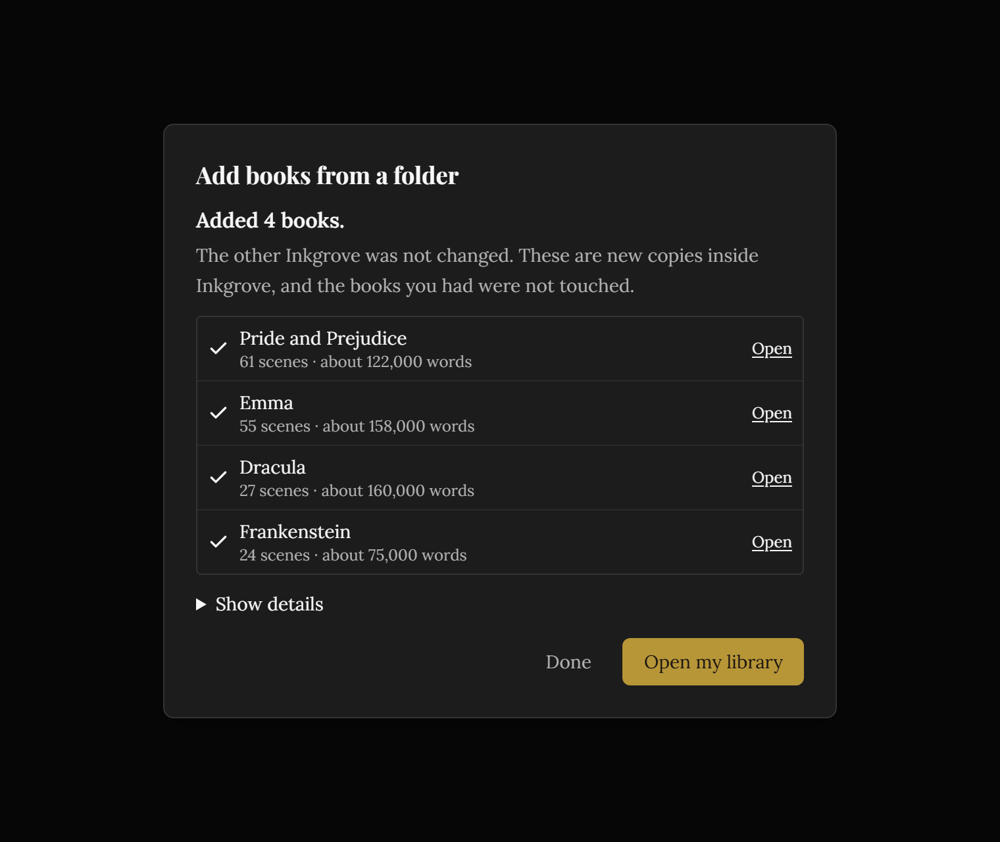

# Inkgrove Alpha

The alpha is where the next version of Inkgrove gets tested before it reaches everyone. Version 0.9.3 is in it now. If you would like to help test it, this page covers what it is, how to install it and how to tell me what you find.

**Expect bugs.** That is the point of it. Something will break, a screen will look wrong, a button will do nothing. When that happens, tell me, because that is how it gets fixed before the live app gets it.

## What it is

Inkgrove Alpha is a separate app. It sits beside your live Inkgrove and does not replace it.

- It has its own name, **Inkgrove Alpha**, and shows an **alpha** badge, so you can tell the two apart.
- It has its own library, settings and backups, in its own data folder (`app.inkgrove.alpha`). The live app keeps `app.inkgrove.desktop`.
- You can have both installed and open on different days. Your live books are not touched by anything you do in the alpha.
- The alpha refuses to open a book folder that the live app uses, so the two apps never write to the same book.

## It changes often

New alpha builds come out frequently, sometimes more than once a day. The alpha checks for updates and offers each new build when it starts, so you stay on the newest one without downloading it again.

Every build is tested before it goes out, but it is tested quickly. A build that was fine yesterday can have a new problem today. Keep your real writing in the live app and use the alpha to try things out and to work on copies.

## Install it

Get the newest file from the [releases page](https://github.com/capactiyvirus/inkgrove/releases). Alpha builds are the ones marked **Pre-release**, named `alpha-0.9.3-<number>-<code>`.

| Computer | File |
|---|---|
| Windows 10 and 11 | `Inkgrove.Alpha_<version>_x64-setup.exe` |
| macOS | `Inkgrove.Alpha_<version>_universal.dmg` |
| Linux | `.deb` (Ubuntu, Debian), `.rpm` (Fedora) or the `.AppImage`. Linux has had the least testing, so tell me how it goes. |

Like the live app, the alpha is not code-signed yet, so Windows and macOS will warn you the first time you open it. The [main page](README.md) has the steps for each.

## Bring your books over

You do not have to start from nothing. The alpha can copy your books out of your live Inkgrove.

1. Close your live Inkgrove first.
2. In the alpha, open the library and press **Import**.
3. Press **Load from another Inkgrove**.
4. Pick **Inkgrove or Inkgrove beta** from the list, which is your live app. It shows how many books it found and when you last saved. If your library is somewhere else, press **Choose a folder** and pick its data folder.
5. Press **Copy and continue**, then choose the books you want and press **Add**.

What to know:

- **Your live library is only read.** Nothing in it changes, and your books there stay as they are.
- **Every book comes in as a new copy.** If the alpha already has a book with the same title, the new one is called `Title (2)`.
- **It brings** the text, the scene versions, the pictures on character sheets and cards, Research, World, Characters and each book's settings.
- **It does not bring** writing dates, shelves, pictures that were not on a sheet or card, writing goal history or History checkpoints. Set those up again in the alpha if you want them.
- When it finishes you get a list of what was added, with word counts, and a note for any book that had a problem.

The import works the same way on Windows and on a Mac, but nobody has tried it by hand on a Mac yet. If you are on a Mac, please tell me how it goes. If it says your live Inkgrove is still open when it is closed, press **Copy anyway**.

## What to try

Anything you normally do is useful. The newest parts of 0.9.3, where problems are most likely, are:

- Research and World as files you can open
- The Canvas corkboard, with its templates, links and drawing tools
- Characters, and the new World sheets and templates
- Shelves in the library
- The rearranged Settings
- Importing your books from the live app, as above

Try it on your own books, because they have things my test books do not.

## Tell me what you find

Join the [Discord](https://inkgrove.app/discord) and say you would like to test the alpha. I will add you to the alpha channel, where testers post what they find and I answer there.

A good report has:

- What you were doing, and what you expected
- What happened instead
- A picture of the screen, if you can
- The version, which is in **Settings, About**
- The log file, if it is a crash or something that will not load. It holds what the app was doing and none of your writing.
  - Windows: paste `%LOCALAPPDATA%\app.inkgrove.alpha\logs` into the Explorer address bar
  - macOS: in Finder press Cmd+Shift+G and paste `~/Library/Logs/app.inkgrove.alpha`
  - Linux: `~/.local/share/app.inkgrove.alpha/logs`

A rough report is still welcome. "It went blank when I opened my second book" is enough to start from.

## Two reminders

- Keep a backup of anything you care about. Use **Export** in the app, or copy your folder.
- The alpha and the live app are separate, so a fix you see in the alpha reaches the live app only when 0.9.3 is released.

Thank you for helping. It makes the live app better for everyone.
